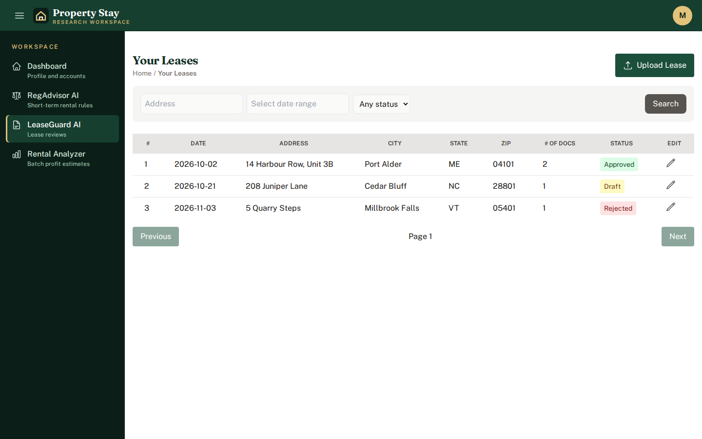
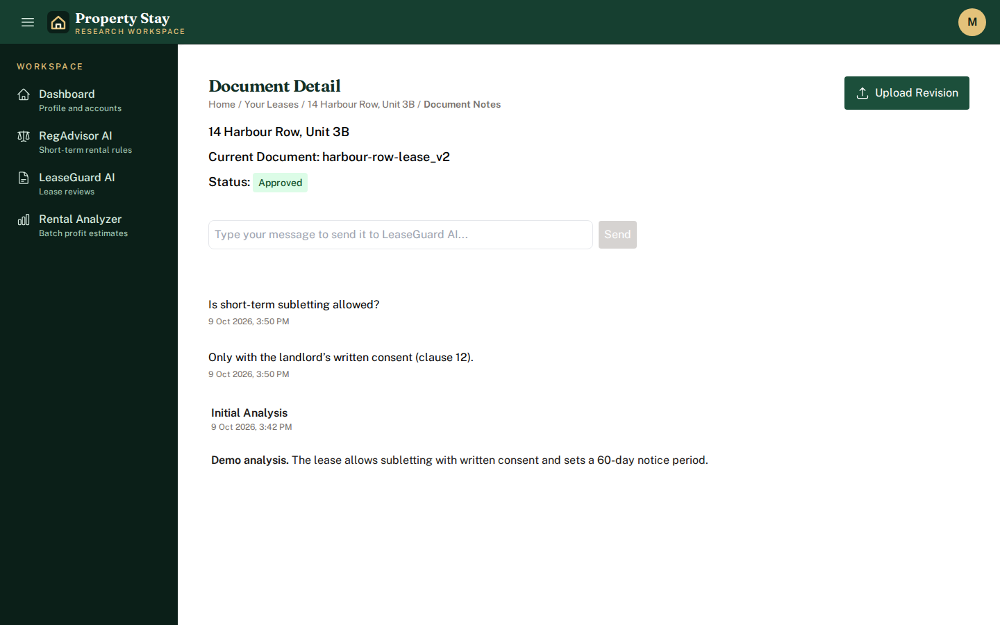
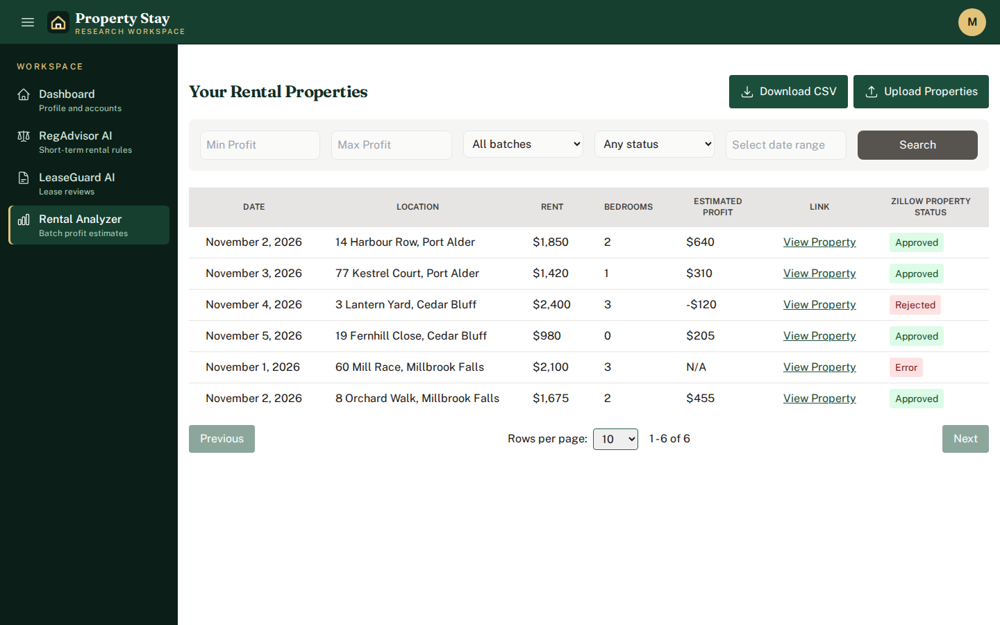
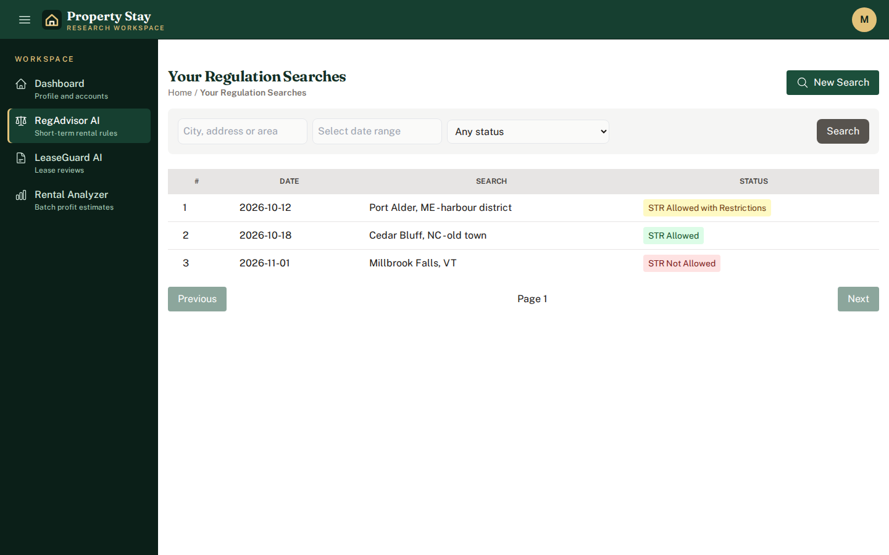
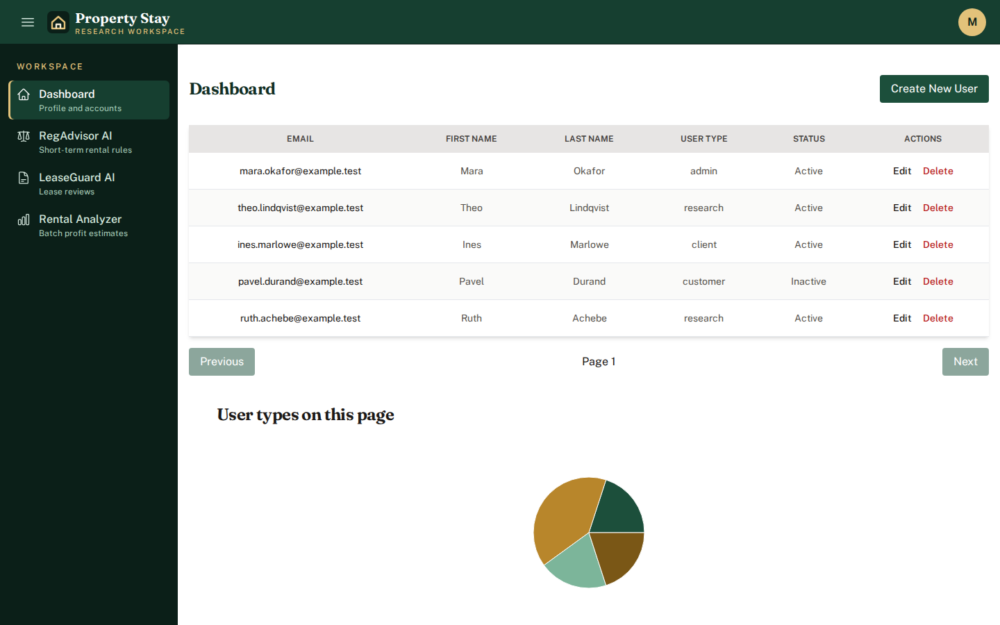
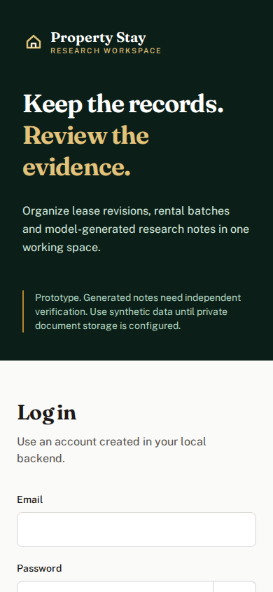
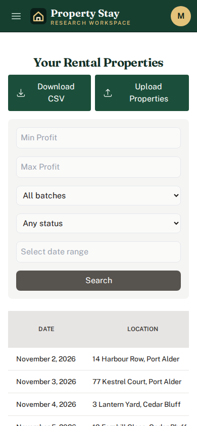
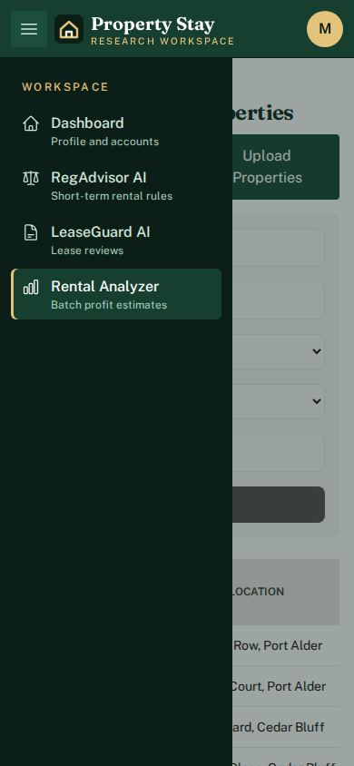
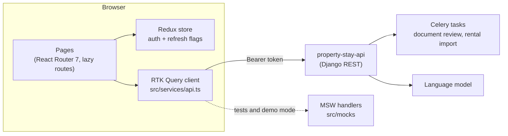

# Property Stay research workspace

A React and TypeScript front end for the property research backend (`property-stay-api`). One workspace holds the three jobs a short-term-rental investor repeats for every deal:

- **LeaseGuard AI**: upload a lease as PDFs, keep each revision, read the model's first analysis and ask follow-up questions per document.
- **RegAdvisor AI**: save a search for a city, address or area, see whether short-term rentals look allowed, restricted or not allowed, and continue the conversation.
- **Rental Analyzer**: import a spreadsheet of listings, follow the background import, then filter the batch by estimated profit, status, batch and date, and export it as CSV.

Admins also get a user table (create, edit, delete) with a breakdown of account types on the current page.

This is a prototype. The model notes are not legal advice, the rental figures are estimates, and the companion API keeps public document uploads off by default. Use synthetic data.



| | |
| --- | --- |
|  |  |
|  |  |

<p>
  
  
  
</p>

Every record in the screenshots is fictional and comes from the demo fixtures in `src/mocks/fixtures.ts`.

## Try it without the backend

Demo mode starts [Mock Service Worker](https://mswjs.io/) in the browser and answers every API call with those fixtures, so nothing leaves the page and any email and password log in.

With Docker only:

```sh
docker build --build-arg BUILD_MODE=demo -t property-stay-web:demo .
docker run --rm -p 8080:80 property-stay-web:demo
```

Then open http://localhost:8080. With Node 22 installed, `npm ci` followed by `npm run demo` does the same on http://localhost:5173.

## Run against property-stay-api

Start the backend first (see its README), create an account there, and allow this app's origin in the backend's `CORS_ALLOWED_ORIGINS`, for example `["http://localhost:8080"]`. There is no sign-up page.

```sh
docker build --build-arg VITE_API_URL=http://127.0.0.1:8000/ -t property-stay-web .
docker run --rm -p 8080:80 property-stay-web
```

Or with Node (version pinned in `.nvmrc`):

```sh
nvm use
npm ci
cp .env.example .env    # VITE_API_URL=http://127.0.0.1:8000/
npm run dev             # http://localhost:5173
```

`VITE_API_URL` is compiled into the JavaScript bundle, so it must never hold a secret. `vercel.json` only rewrites every path to `index.html` so client-side routes survive a refresh on Vercel.

## Check it

```sh
npm run lint     # ESLint 10, zero warnings allowed
npm test         # Vitest + Testing Library against MSW, no network
npm run build    # tsc, then the production bundle
```

`docker build --target check .` runs the lint and test steps in a clean Node 22 container.

The 41 tests render the real route table against handlers that mirror the API contract (`src/mocks/handlers.ts`). They cover the lease list, search, empty and error states; documents and notes, including a failed question; rental formatting, filters, validation and a failed import task; regulation listing and creation; admin and non-admin dashboards, the first-login password redirect and logging out when the API refuses. `src/services/api.test.ts` checks how filters map onto query strings and request bodies. Nothing here calls OpenAI, document storage or a real backend; the API has its own tests.

## How it fits together



| Route | Page |
| --- | --- |
| `/` | Login, with an optional "remember email" |
| `/dashboard` | Profile, or the user table for admins |
| `/update-password/:id` | First-login password change (non-admins are sent here automatically) |
| `/leases`, `/lease/:id` | Leases, their documents and revisions |
| `/lease/:id/documents/:documentId/notes` | Analysis and questions for one document |
| `/preview/:documentId` | The stored PDF in a frame |
| `/regulations`, `/regulation/new`, `/regulation/:id/chat` | Regulation searches |
| `/rental-analyzer` | Rental import, filters, CSV export |

## Design notes

- **Analysis runs in the background.** After an upload the client asks the API to review each document, then polls the notes endpoint every three seconds until the analysis reports a status, or until 20 minutes after the upload so a lost task cannot poll forever.
- **Imports are tracked by task id.** The rental page polls task progress and result. A failed Celery task comes back as HTTP 500, so the client reads the failure from the error body, ends the overlay and says so.
- **The API's date formats differ.** Lease and regulation searches take `YYYY-MM-DD`; the rental filter takes "Month day, year". Picked dates are sent as local calendar days, not converted to UTC first.
- **CSV export is fetched on click**, with the filters in force at that moment.
- **Credentials.** "Remember email" stores only the email, and any password left in browser storage by older builds is removed on load. The access token lives in `localStorage`, readable by page scripts; moving to an HttpOnly session needs a change on both sides. Logging out always clears the local session and the request cache, even if the API call fails. The route guard only checks that a token exists; the API decides what each user may see.
- **Documents.** The backend's legacy uploader makes files public, which is why it ships with uploads disabled. Do not enable it for real leases until private storage exists. Password reset is not offered because the API has no verified delivery for it.

## Known limits

- React 18 and Tailwind CSS 3 are kept; React 19 and Tailwind 4 would each be a migration of their own. `react-datepicker` (7) and `react-dropzone` (14) are a major version behind and are not covered by tests that would show a regression.
- There is no end-to-end test against a running property-stay-api.
- Table sorting on the rental page sorts the current page only; the API orders pages by date.

## License

MIT, see [LICENSE](LICENSE).
