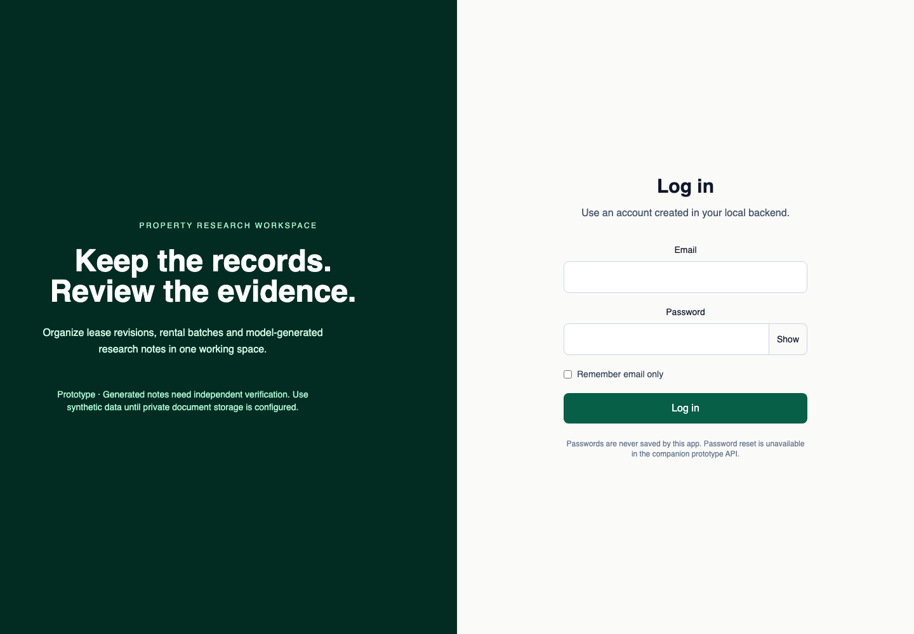

# Property research workspace

A React and TypeScript interface for the property research backend (`property-stay-api`). It brings together lease revisions, document notes and chats, model-generated regulation notes, rental batches, and account administration.

This is an API-connected prototype. It does not verify legal conclusions or rental projections, and the companion backend disables public document uploads by default. Use synthetic data for demonstrations.



The screenshot shows the local login page with empty fields. It does not imply that an external account, model or storage provider was contacted.

## Run with the local backend

Use Node 22 for the current test toolchain. Vite and React retain their existing major versions.

```sh
git clone <repository-url> property-stay-web
cd property-stay-web
npm ci --ignore-scripts
cp .env.example .env
npm run dev
```

Set `VITE_API_URL=http://127.0.0.1:8000/` and allow the Vite origin in the backend's `CORS_ALLOWED_ORIGINS`, for example `["http://localhost:5173"]`. Start the backend separately and create an account there. The frontend has no public signup flow or bundled demo credentials. Vite environment variables are embedded in the client bundle: put no private credentials in them.

## Pages and data flow

| Page | Purpose |
| --- | --- |
| `/` | Login, optional email-only recall and visible request errors |
| `/dashboard` | User profile or account administration, according to API role data |
| `/leases` | Lease list, revisions and document actions |
| `/regulations` | Saved model-generated location notes and chat |
| `/rental-analyzer` | Rental imports, task progress, filtering and results |
| `/update-password/:id` | Authenticated first-login password update with confirmation |

RTK Query in `src/services/api.ts` defines requests. Redux holds auth and refresh/polling flags. React Router connects page components; shared tables, forms, modals and navigation live in `src/components`. Tailwind supplies the page styles. Authenticated pages load as separate route chunks so the login page does not eagerly load every workspace screen. This is a Vite app, not a Next.js application.

The first-login request uses the backend's POST contract with `new_password` and `confirm_password`. Document-preview metadata is JSON containing a file URL, rather than a binary file response. Backend authorization must decide access; the client route guard only redirects when it has no token.

## Credential and document handling

The old remember-me implementation stored a raw password in browser storage. It now remembers only the email and removes any legacy `password` value when the app loads. Use a browser password manager for password recall.

Access tokens still live in `localStorage` and are readable by JavaScript. Moving to a server-managed HttpOnly session would require an authentication design change across both repositories. There is no complete automatic refresh/revocation lifecycle here; expired tokens can require login again. Cached client role labels are presentation hints, not permissions.

The companion API's default upload restriction is intentional: its legacy Cloudinary uploader makes files public. Do not enable it for real lease documents until private storage is implemented. Existing remote documents are not made private by updating this UI. Password reset is also unavailable until the backend has verified delivery and a confirmation endpoint.

## Check the frontend

```sh
npm test
npm run build
```

The focused suite covers protected-route redirects, login rendering, removal of legacy saved passwords, email-only recall, failed login feedback and malformed persisted user data. The production build runs TypeScript before Vite.

These checks do not exercise live OpenAI, document storage, rental providers or the complete multi-user backend flow. Some administrative and analysis screens retain prototype behavior. The API has its own isolated access-control tests; those are not a substitute for browser-level end-to-end coverage.

Use npm and its lockfile for this checkout. The old duplicate Yarn lock was removed to avoid implying that both package managers produce the same installation. No license file is present.
